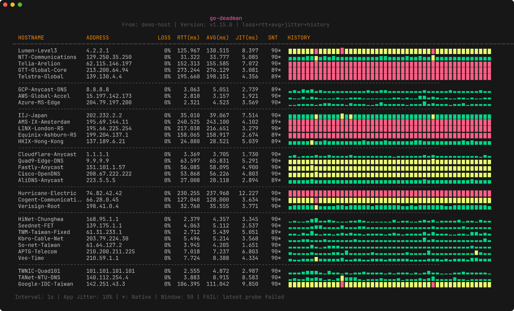

# 💀 go-deadman



> A terminal dashboard that tracks **ICMP latency, jitter and packet loss** for many targets at once — a single executable with its target list built in.


[](LICENSE)

Inspired by [upa/deadman](https://github.com/upa/deadman).

---

## ✨ Features

- **Responsive TUI** (Bubble Tea + Lipgloss) — columns adapt to the terminal width, CJK-aware, never overflow
- **Socket-reuse ping engine** (`pro-bing`, infinite-send mode) — every probe tracked by sequence number
- **Metrics** — loss %, last RTT, moving-average RTT, jitter, settled probe count, sparkline history
- **Fallback** to the OS `ping` command when raw ICMP is unavailable
- **DNS resolution** — give only a hostname or only an IP
- **Embedded presets** with a runtime `-config` override
- **Redraws only when data changes** (max 20 fps)

---

## 📦 Download

Grab a zip from [Releases](https://github.com/sinnoken/go-deadman/releases):

| Asset | Embedded targets |
|---|---|
| `go-deadman-internet-windows-amd64.zip` | Global ISPs, cloud anycast, IXPs, DNS, Taiwan ISPs |
| `go-deadman-tasks-windows-amd64.zip` | LAN targets |

Each release ships `SHA256SUMS.txt`, and every binary has a GitHub build-provenance attestation, so you can prove it was built by this repository's CI from a specific commit:

```bash
gh attestation verify go-deadman.exe --repo sinnoken/go-deadman
```

---

## 🚀 Usage

```bash
go-deadman                     # use the embedded preset
go-deadman -config my.yaml     # use an external config instead
go-deadman -version
```

Press **`q`** or **`Ctrl+C`** to exit.

### Native ICMP vs fallback

| OS | Native mode needs |
|---|---|
| **Windows** | Run as **Administrator** |
| **Linux** | Unprivileged ICMP (`net.ipv4.ping_group_range`), enabled on most distros |
| **macOS** | Nothing extra |

Without it, each target **falls back** to the OS `ping` command automatically. Native targets are marked with `*` after SNT.

---

## ⚙️ Configuration

Presets live in [`presets/`](presets/) and share one schema:

```yaml
interval: 1s       # probe interval, Go duration, >= 100ms (default 1s)
jitter: 0.1        # ±10% random spacing in fallback mode, 0 < jitter < 1 (default 0.1)
devices:
  - name: "Cloudflare"
    ip: "1.1.1.1"
  - name: "---"          # separator row
  - name: "nas.lan"      # name only → IP resolved via DNS
  - ip: "192.168.1.1"    # IP only → name via reverse DNS
```

The file is validated at startup (interval, jitter range, each device has a name or a valid IP). Invalid files exit with a message; unknown keys are ignored.

---

## 📊 Columns

| Column | Meaning |
|---|---|
| **LOSS** | Lost ÷ SNT. Non-zero loss is never shown as `0%` (`<0.1%`, one decimal below 10%), and is never rounded up to `100%` |
| **RTT** | Most recent successful RTT; **`FAIL`** (row in red) when the latest probe failed |
| **AVG** | Mean of the last 50 successful RTTs |
| **JIT** | Mean absolute difference between RTTs of *adjacent successful* probes (last 50 pairs); a lost probe breaks the pair. Same rule in native and fallback mode |
| **SNT** | Settled probes (replied or timed out). Each sequence number counts once; replies arriving after the timeout are ignored |
| **HISTORY** | Newest on the left; bar height is log-scaled RTT, `·` = lost |

Probe timeout is `max(interval, 1s)` in both modes. On narrow terminals columns drop in this order: HISTORY, SNT, JIT, AVG, ADDRESS, LOSS — HOSTNAME and RTT always stay.

---

## 🛠️ Building

Requires Go 1.25+.

```bash
go build -trimpath -ldflags="-s -w" -o go-deadman ./cmd/go-deadman              # internet preset
go build -trimpath -ldflags="-s -w" -tags tasks -o go-deadman ./cmd/go-deadman  # tasks preset
```

Windows icon and version info (optional):

```bash
go install github.com/tc-hib/go-winres@latest
go-winres make --in winres/winres.json --out cmd/go-deadman/rsrc --product-version 1.2.3 --file-version 1.2.3
```

### Project layout

| Path | Contents |
|---|---|
| `cmd/go-deadman/` | Entry point: flags, config source, program start |
| `internal/monitor/` | Config loading/validation, ping workers (`probeTracker`, fallback), per-target statistics |
| `internal/tui/` | Bubble Tea model, width-aware layout, rendering |
| `presets/` | Target lists and their build-tag-selected embedding |
| `winres/` | Windows icon and version-info manifest |

### Tests and checks

```bash
go vet ./... && go vet -tags tasks ./...
go test ./... && go test -tags tasks ./...    # add -race where cgo is available
go test ./internal/monitor -run '^TestProbeTracker$' -count=1
```

CI (`.github/workflows/build.yml`) runs a tidy check, gofmt, vet, race tests, golangci-lint, govulncheck and gosec on every push and PR. Pushing a `v*` tag builds both presets, attests them and publishes a release; the tag becomes the app version and the Windows file version.

---

## 📄 License

[MIT](LICENSE)
