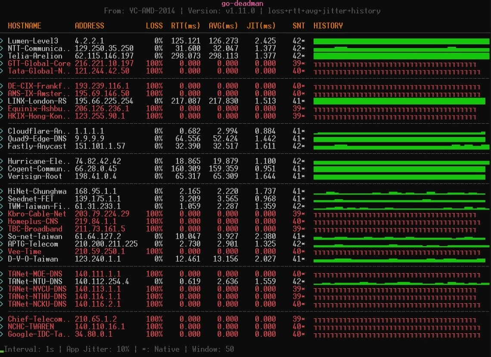

# 💀 go-deadman



> A Terminal UI (TUI) network monitor that tracks **ICMP ping latency, jitter, and packet loss** across multiple targets simultaneously — shipped as a single executable with its target list built in.


Inspired by https://github.com/upa/deadman

---

## ✨ Features

| Feature | Description |
|---|---|
| 🎨 **Responsive TUI** | Bubble Tea + Lipgloss; columns adapt to the terminal width (CJK-aware) and never overflow it |
| ⚡ **Socket-reuse ping engine** | `pro-bing` in infinite-send mode; each probe is tracked by sequence number |
| 📊 **Metrics** | Loss %, last RTT, moving-average RTT, jitter, settled probe count |
| 📈 **Sparkline history** | `▁▂▃▄▅▆▇█` scaled logarithmically, `·` for a lost probe |
| 🔄 **Fallback** | Uses the OS `ping` command when raw ICMP is unavailable |
| 🌐 **DNS resolution** | Give only a hostname or only an IP; the other is resolved |
| 🧩 **Embedded presets** | Target list compiled in via `//go:embed`; override at runtime with `-config` |
| 🪟 **Windows resources** | Icon and version info embedded with `go-winres` |

---

## 🚀 Getting Started

Requires Go 1.25+.

```bash
git clone https://github.com/sinnoken/go-deadman.git
cd go-deadman

go build -trimpath -ldflags="-s -w" -o go-deadman .              # embeds presets/internet.yaml
go build -trimpath -ldflags="-s -w" -tags tasks -o go-deadman .  # embeds presets/tasks.yaml
```

```bash
./go-deadman                      # use the embedded preset
./go-deadman -config my.yaml      # use an external config instead
./go-deadman -version
```

Press **`q`** or **`Ctrl+C`** to exit.

### Native ICMP vs fallback

| OS | Native mode needs |
|---|---|
| **Linux** | Unprivileged ICMP (`net.ipv4.ping_group_range`) — enabled on most distros |
| **macOS** | Nothing extra |
| **Windows** | Run as **Administrator** |

Without it, the target **automatically falls back** to the OS `ping` command. Native targets are marked with `*` next to SNT.

---

## ⚙️ Configuration

Presets live in [`presets/`](presets/) and share one schema:

```yaml
interval: 1s       # probe interval, Go duration, >= 100ms (default 1s)
jitter: 0.1        # ±10% random spacing in fallback mode, 0 < jitter < 1 (default 0.1)
devices:
  - name: "Cloudflare"
    ip: "1.1.1.1"
  - name: "---"          # separator row
  - name: "nas.lan"      # name only → IP resolved via DNS
  - ip: "192.168.1.1"    # IP only → name via reverse DNS
```

The config is validated at startup (interval, jitter range, every device has a name or a valid IP); an invalid file exits with an error message. Unknown keys are ignored.

---

## 📊 Dashboard

```
  HOSTNAME             ADDRESS               LOSS  RTT(ms)  AVG(ms)  JIT(ms)   SNT   HISTORY
  ────────────────────────────────────────────────────────────────────────────────────────────
  Cloudflare           1.1.1.1                 0%    2.341    2.298    0.103   142*  ▃▃▃▃▄▃▄▃
  HiNet-DNS            168.95.1.1            0.7%     FAIL    4.011    0.214   142*  ▃▃▃▄▃▃▃·
```

| Column | Meaning |
|---|---|
| **LOSS** | Lost ÷ SNT. Non-zero loss is never shown as `0%` (`<0.1%`, one decimal below 10%), and is never rounded up to `100%` |
| **RTT** | Most recent successful RTT; shows **`FAIL`** (row in red) when the latest probe failed |
| **AVG** | Mean of the last 50 successful RTTs |
| **JIT** | Mean absolute difference between RTTs of *adjacent successful* probes (last 50 pairs); pairs never span a lost probe. Same rule for native and fallback |
| **SNT** | Settled probes (replied or timed out). In-flight probes are not counted; each sequence number is counted once, and late replies after a timeout are ignored |
| **HISTORY** | Most recent probe on the left |

On narrow terminals columns are dropped in this order: HISTORY, SNT, JIT, AVG, ADDRESS, LOSS. HOSTNAME and RTT are always shown.

The probe timeout is `max(interval, 1s)` for both native and fallback modes. The screen is only redrawn when data changes, at most 20 times per second.

---

## 🗂️ Layout

| File | Contents |
|---|---|
| `main.go` | Flags, config source selection, program start |
| `config.go` | `Config`, `loadConfig` (parse, defaults, validation) |
| `stats.go` | `Device`, `UpdateStats`, loss formatting, sparkline |
| `ping.go` | DNS resolution, native worker + `probeTracker`, fallback worker, `parseRTT` |
| `ui.go` | Bubble Tea model, on-demand redraw, width-aware layout |
| `preset_*.go` | Build-tag selection of the embedded preset |
| `presets/` | `internet.yaml` (global / Taiwan backbone), `tasks.yaml` (LAN) |
| `winres/` | Windows icon and version-info manifest |

---

## 🧪 Development

```bash
gofmt -l .
go vet ./... && go vet -tags tasks ./...
go test ./...                     # add -race where cgo is available
go test -tags tasks ./...
go test -run '^TestProbeTracker$' -count=1 .
```

---

## 🤖 CI/CD

`.github/workflows/build.yml`:

| Trigger | Jobs |
|---|---|
| Push / PR to `main` | `test`: tidy check, gofmt, vet, `go test -race` (both presets), golangci-lint, govulncheck, gosec |
| Tag `v*` | `test` → `build` → `release` (binaries + `SHA256SUMS.txt`) |
| Manual dispatch | `test` → `build` |

`build` produces `deadman-{internet,tasks}-windows-amd64.exe`. The tag is injected as the app version (`-X main.version`) and as the Windows file/product version (`go-winres`). Dependabot keeps Go modules and Actions up to date.

---

## 📄 License

MIT License. Copyright © 2026 go-deadman contributors.
